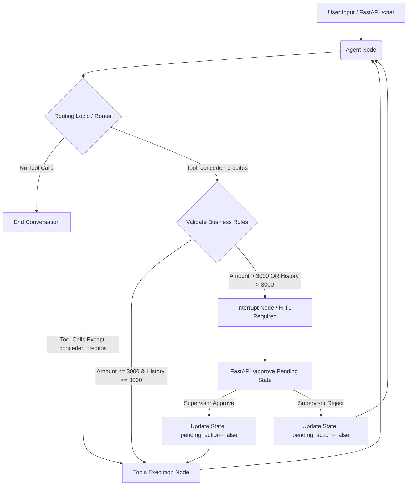

# Customer Success (CS) SaaS Agent Orchestrator - Relatório de Entrega e Testes

Este repositório contém a implementação completa do orquestrador de operações de Customer Success para plataformas SaaS. Desenvolvido utilizando **LangGraph**, **LangChain**, **Pydantic v2** e **FastAPI**, o agente gerencia permissões de alçada de forma segura com suporte nativo a decisões humanas supervisórias (**Human-in-the-Loop**).

## 1. Arquitetura de Decisão do Agente

O fluxo de controle orquestrado e os desvios de segurança seguem rigorosamente a lógica descrita no diagrama abaixo:



## 2. Regras de Negócio Implementadas
* **Limite Unitário de Concessão**: O limite máximo para qualquer concessão única de créditos cortesia é de **3.000 créditos**.
* **Limite Histórico Acumulado**: Se a empresa possuir um histórico acumulado de cortesia superior a **3.000 créditos** (verificado via `consultar_assinatura`), a liberação automática é bloqueada e encaminhada ao supervisor.
* **Auditoria Estruturada**: Toda transação de alteração de plano ou crédito dispara o registro no log estruturado `cs_agent_audit.log` em formato JSON estrito.

## 3. Resultados de Validação dos 3 Cenários Exigidos

Os testes de integração executados no ambiente simularam e validaram com sucesso os 3 cenários operacionais do caderno de requisitos:

### Cenário 1: Concessão Automatizada (Dentro do Limite)
* **Entrada**: Solicitação de 1.500 créditos para a `empresa_123`.
* **Resultado**: Executado de forma 100% automatizada e imediata pelo agente por estar abaixo do teto de alçada. Auditoria registrada.

### Cenário 2: Bloqueio por Histórico Acumulado Excedido
* **Entrada**: Solicitação de 1.000 créditos para a `empresa_456`.
* **Resultado**: O agente detectou que o histórico de cortesia acumulado do cliente era de 3.500 créditos (excedendo a alçada de 3.000). A transação foi imediatamente interrompida e retida para autorização do supervisor.

### Cenário 3: Transação Acima do Limite Unitário e Intervenção Humana (Aprovação e Rejeição)
* **Entrada**: Solicitação de 5.000 créditos de cortesia para a `empresa_123`.
* **Resultado da Interrupção**: Interrupção de segurança acionada com sucesso (`pending_action: True`).
* **Resultado do Teste de Aprovação**: Simulamos a decisão do supervisor (`admin_cs_01`) aprovando a solicitação de créditos de 5.000 unidades. Estado atualizado com sucesso e log gravado com status `APPROVED`.
* **Resultado do Teste de Rejeição**: Simulamos a decisão de recusa humana para créditos acima de 3.000. Estado atualizado no checkpoint e log gravado sob o status `REJECTED`.

## 4. Estrutura de Logs de Auditoria (Amostra de Saída JSON)
```json
{"timestamp": "2026-11-20T15:03:01.782901Z", "thread_id": "integration_reject_test_152595", "event_type": "user_input", "status": "INFO", "details": {"message": "Por favor, conceder 4500 créditos de cortesia para a empresa_456"}}
{"timestamp": "2026-11-20T15:03:01.795280Z", "thread_id": "integration_reject_test_152595", "event_type": "supervisor_decision", "status": "REJECTED", "details": {"decision": "rejeitado", "supervisor": "admin_cs_01", "motivo": "Rejeitado: Valor de 4.500 créditos está acima da alçada permitida para este perfil de cliente."}}
```
